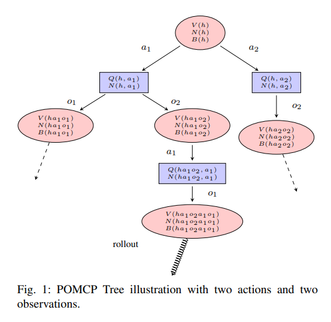
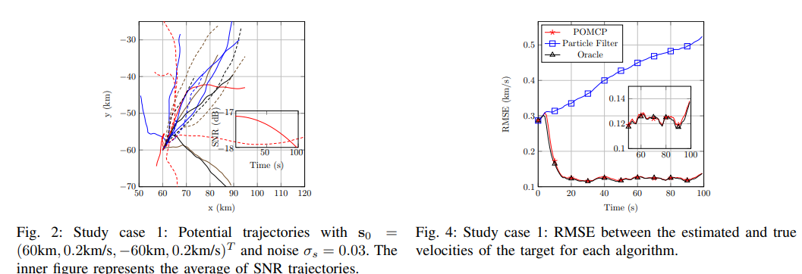
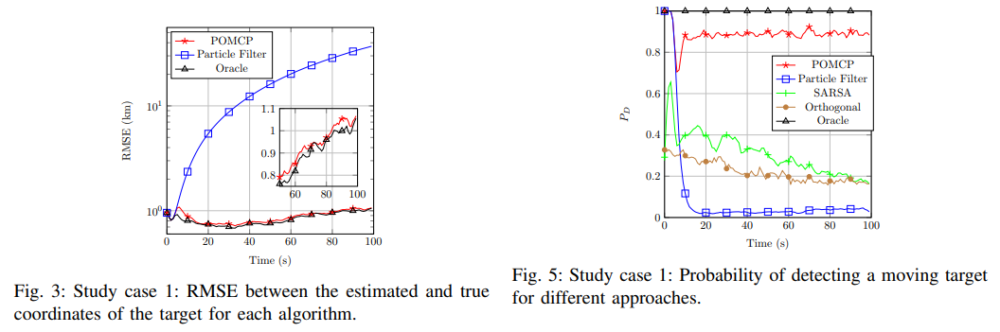
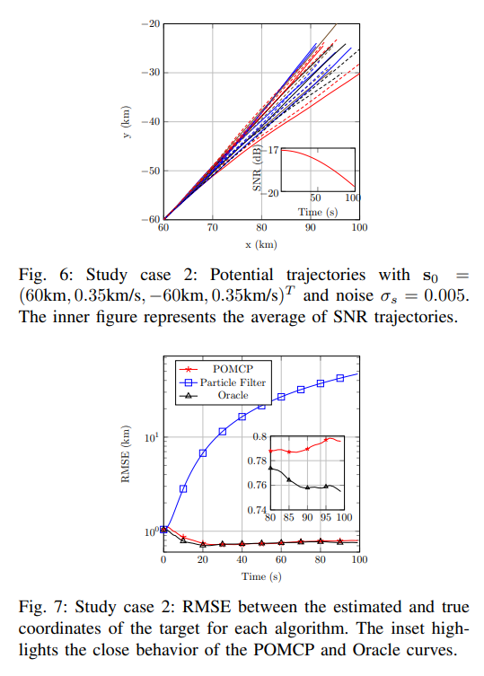
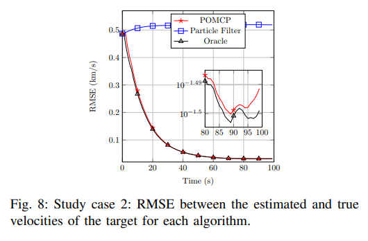
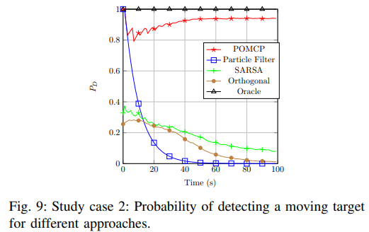
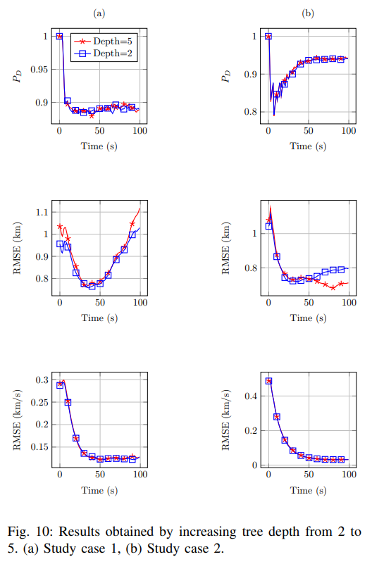
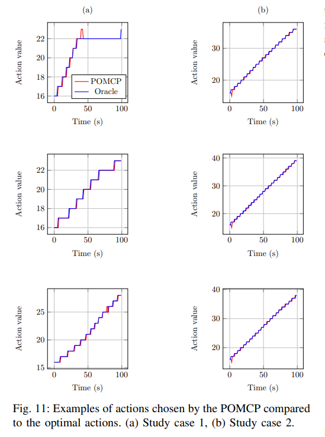

# New Cognitive Radar Breakthrough: POMDP-Driven Massive MIMO for simultaneous detection and tracking of targets in unknown interference[with Python code]

Cognitive Radar Breakthrough: POMDP-Driven Massive MIMO for simultaneous detection and tracking in unknown interference
When radars no longer preset noise distributions but act like intelligent agents, "thinking" about which direction to direct energy—even when the statistical distribution of interference is completely unknown, it can still stably track high-speed targets. Traditional radars typically assume that noise follows a known distribution (such as Gaussian white noise), but in real battlefields and urban low-altitude environments, interference is often non-Gaussian, non-stationary, and unknown in statistical terms. To address this challenge, cognitive radars have emerged—they can dynamically adjust the emission waveform based on environmental feedback. However, existing cognitive radar algorithms either require known interference statistics or only solve the detection problem while ignoring tracking, or rely on offline training datasets (difficult to cover all scenarios).
This paper proposes a novel solution: modeling the joint detection-tracking problem of Massive MIMO (MMIMO) radar as a partially observable Markov decision process (POMDP). Leveraging the robustness of MMIMO radar's "vast virtual channels"—even when the distribution of interference is unknown, it ensures a constant false alarm rate (CFAR)—combined with the online planning algorithm POMCP (Partially Observable Monte Carlo Planning), the radar can choose the optimal emission angle (i.e., waveform matrix) based on historical observations in real time, while also estimating the target's position and velocity.
The key innovation lies in:
No need for any prior knowledge of interference: By constructing a black-box generator through the asymptotic theory of MMIMO, replacing the known observation probability model required by traditional POMDP.
Joint detection and tracking: The reward function is designed to "predict the target's angle of incidence," driving the radar to actively pursue the target.
Completely online: No need for offline training datasets, highly adaptive.
Superior to SARSA: Compared with traditional reinforcement learning algorithms (SARSA), POMCP improves the detection rate by more than three times under low signal-to-noise ratio and high-speed target scenarios.
Simulation results show that, even at a target signal-to-noise ratio as low as -20dB and a speed of 350m/s, the POMCPC can maintain a detection probability above 0.8, while traditional particle filtering and SARSA quickly fail.
I. Introduction: Why is robustness under "unknown interference" necessary for cognitive radar? 1.1 The leap from "known" to "unknown" in traditional radar design typically assumes that interference (noise, clutter) follows a known probability distribution (most commonly Gaussian white noise). This assumption allows us to design optimal detectors under the Nyquist-Pearson criterion, such as matched filters. However, in real environments, interference may be caused by non-Gaussian, spatiotemporal correlated, and statistical unknown signals due to human interference, non-uniform clutter, or sporadic pulses. If the model is wrong, detection performance will severely degrade, leading to uncontrolled false alarm rates.
The introduction of cognitive radar aims to address this issue: radars improve their detection and tracking performance by actively perceiving the environment and adjusting waveforms. However, most cognitive radar schemes either still assume an unknown interference model (such as Bayesian methods) or only optimize detection while ignoring tracking, or require extensive offline training data (e.g., deep reinforcement learning) — collecting all possible environmental and trajectory data in radar is impractical.
1.2 The unique advantages of large-scale MIMO radar Large-scale MIMO radar (MMIMO) equipped with a large number of transmitting and receiving antennas forms thousands of virtual channels. In recent years, theoretical findings have shown that even if the exact distribution of interference is unknown, as long as its autocorrelation function decays at a polynomial rate, the test statistic of Wald-type detectors based on MMIMO will asymptotically follow a chi-square distribution, allowing for **constant false alarm rate (CFAR)** threshold setting. This means that the detector itself is "distribution-unknown robust."
However, this detector can only provide binary decisions about whether there is a target and an estimate of the target power. It cannot automatically maximize the detection probability or track the movement of the target. Therefore, higher-level decision strategies are needed to guide the radar's next move.
1.3 Existing solutions' shortcomings and the introduction of Sparse Reinforcement Learning (SARSA) algorithm: Model waveform selection as a Markov Decision Process (MDP), assuming full observability of states. However, in practice, radars can only infer target positions through noisy observations, making states partially observable. SARSA is effective when targets are stationary or moving slowly, but its performance sharply deteriorates in high-speed dynamic scenarios.
Particle Filter + fixed policy: Only perform state estimation without action optimization, easily losing the target.
Deep Reinforcement Learning (DRQN, etc.): Requires large amounts of offline training data and is sensitive to environmental changes.
**Partially Observable Markov Decision Process (POMDP)** is naturally suited for radar tracking problems: The position and velocity of the target are hidden states (not directly observable), and radars can only obtain observations from detectors (detection or non-detection, as well as an estimate of the target power). The online solver (such as POMCP) of POMDP can plan online without prior knowledge of transition probabilities and observation probabilities—this is the core idea of this paper.
2.1 MMIMO radar signal model Consider a co-located MIMO radar with number of transmitting antennas, receiving antennas, and virtual channels (typically 10,000). The radar's field of view is discretely divided into angle units.
In time step, the radar selects a waveform matrix, which is determined by the solution of problem (3): To focus energy on a certain angle, take the square root. This is the radar's action: selecting an angle bin.
Received signal model:
Where is an unknown distribution of interference, determined by the known vector action and steering vector, and is the target complex scattering coefficient (inversely proportional to the square of the distance).
2.2 Robust Wald detector and its asymptotic distribution The following test statistic is proposed in the literature:
Where is the estimated, and is the estimate of the interference covariance. Key conclusion:
Under condition, (central chi-square), thus thresholds can be set to ensure constant false alarm rate.
Under condition,, the non-central parameter is related to the target power, waveform, and interference covariance.
Based on Marcum Q function approximation, the detection probability can be estimated.
2.3 Modeling cognitive radar as a POMDP: We map the problem to six elements of a POMDP:
State: The position and velocity of the target, which is represented by. State transition follows a linear Gaussian model (constant velocity plus process noise).
Action: Selects the angle bin, equivalent to choosing the next waveform.
Observation: If detection occurs (), then observes a continuous value, otherwise an empty observation. To discretize, set a discreteization step, mapping continuous observations to discrete intervals.
Observation probability: Unknown! Because the distribution of interference is unknown. This is precisely why traditional POMDPs are difficult to directly apply.
Transition probability: Determined by the kinematics of the target, independent of the action.
Reward function: Rewards 1 if the radar's selected action angle matches the true angle at the next moment in time, otherwise 0. This encourages the radar to actively pursue the target.
The core method: Using a generator instead of an unknown observation model
3.1 Assumptions of traditional POMCP: A well-known online POMDP planning algorithm, it estimates the current state value by simulating future action-observation trajectories through Monte Carlo tree search. It assumes that we can call a black-box generator, sampling from both the transition distribution and the observation distribution. However, we do not know the specific form of the observation distribution.
3.2 Utilizing asymptotic theory to construct the generator: To address this challenge, this paper cleverly leverages the asymptotic results of MMIMO radar:
From (23), it is known that the estimated target power is approximately Gaussian around the true value, with variance estimated from data.
Therefore, the generator (Algorithm 3) can:
Predict the next state based on the current state and action (i.e., the selected angle bin).
Calculate the true target angle and RCS.
Generate with Gaussian noise.
Compute the test statistic and compare it with a threshold to decide whether detection occurred.
If detection is detected and the angle matches, output the observed value (discretized).
Reward is 1 if the prediction angle is correct, otherwise 0.
Key Point: This generator does not rely on the true distribution of interference, but only on the estimated and asymptotic properties from data. Therefore, even if the true interference is unknown, we can still run POMCP for online planning.
3.3 Joint Particle Filtering and POMCPPOMCP require maintaining belief (belief) within tree search - that is, the posterior distribution of the target state. This paper adopts unweighted particle filtering (with each particle weight considered equal), with a particle set size. For each time step:
1  
Approximate belief using the current particle set.
2  
Run the POMCP (Sub-optimal Model Checking) from the root node, using a generator to simulate unfolding, and ultimately select the optimal action.
3  
Execute the action to obtain the true echo signal, calculate the true observation (observations generated by real interference during actual system operation).
4  
Updating Beliefs: Utilize Particle Filtering to simulate a step for each particle using a generator, retaining only those particles whose simulated observations match the true observations. Repeat until the new particle set is filled.
During this process, POMCP is used for action selection, and particle filtering is used for state estimation, both sharing the same generator.
IV. Simulation Verification and Performance Comparison 4.1 Experimental setup includes the number of virtual channels, angle units, total power, and false alarm rate.
Interference model: 6th order autoregressive process, innovation distribution is (, heavy-tailed non-Gaussian), all coefficients are complex numbers, simulates highly non-stationary and non-Gaussian interference.
Two typical scenarios:
Slow target
Initial position (60km, -60km), speed (0.2km/s, 0.2km/s), process noise, SNR average about -17dB gradually decrease to -18dB.
Fast target
Speed (0.35km/s, 0.35km/s), noise, SNR from -17dB to -20dB.
Comparative algorithms: Oracle (forecasting future perspective, as a performance upper bound), Particle Filter (no planning, fixed actions), SARSA (previous RL method), Orthogonal Waveform (without waveform optimization).
4.2 Results Analysis Figures 3 and 4 (Slow Target):
The RMSE of particle filter position rapidly increases with time (target loss).
The RMSE of POMCP is very close to that of Oracle, always staying within 5km.
In terms of speed estimation, the initial bias of POMCP is large, but it quickly converges with the accumulation of observations.
Figure 5 (Detection Probability, Slow Target):
Orthogonal waveform: Always below 0.2.
SARSA: slight increase, but still below 0.4.
Particle Filter: Initially barely maintained, but fell below 0.2 after about 30 steps.
POMCP: Maintain above 0.8 within 100 steps, close to Oracle.
Figures 7, 8, 9 (Fast Target):
Trends are similar, but all algorithms have slightly lower performance (lower SNR).
POMCP still remains, while SARSA and particle filter almost drop to 0.
Figure 10 (Tree Depth Impact):
Deep 2 is better or comparable to deep 5 in most cases. The reason is that the generator's approximation bias accumulates with the number of simulation steps, and shallower trees rely more on real observations for correction.
Figure 11 (Action Analysis):
The action selected by POMCP is highly consistent with the optimal action (target real angle), indicating that the algorithm truly learned to "chased" the target.
V. Conclusions and Research Inspirations 5.1 Contributions of the Paper 1
The first work to use POMCP for joint detection and tracking in MMIMO radar, without relying on prior knowledge of interference.
2  
By designing the generator, it cleverly bypasses the unknown obstacles of the observation model and realizes the online planning with the asymptotic statistical characteristics of MMIMO.
3  
Under extreme non-Gaussian, low SNR, and high-speed motion conditions, the detection probability is more than 3 times higher than that of SARSA, and the tracking accuracy is close to that of Oracle.
5.2 Three insights for researchers
Insight 1: The "online" attribute of cognitive radar is far more practical than "offline training." In the ever-changing deployment environment of radar, it's nearly impossible to pre-collect all possible interference and trajectory datasets. The POMCP method operates entirely online without a training phase and can adapt to environmental changes. In contrast, while deep reinforcement learning is powerful, its actual implementation in the field of radar is limited by data acquisition. This suggests that in sensor domains, unmodeled online planning algorithms may be more resilient than data-driven black-box methods.
Insight 2: "Partially observable" is the norm in radar, which should be explicitly modeled. Many radar tracking studies simplify the problem to an MDP (assuming full state knowledge), but in reality, radar can only infer target states indirectly through echoes. This paper explicitly models target states as hidden variables and handles them with a POMDP using particle filtering to maintain beliefs. This belief-driven decision-making approach is more robust than directly maximizing instantaneous detection probabilities—it takes uncertainty into account.
Insight 3: Domain knowledge and asymptotic theory can "replace" complex probability models. POMDPs typically require known observation probabilities, which are often unknown in radar. This paper does not attempt to estimate interference distributions; instead, it leverages the law of large numbers from MMIMO to construct a sampleable generator. This approach can be generalized to other high-dimensional, asymptotically Gaussian sensor problems: as long as we can asymptotically approximate posterior sampling, online planning can be solved.
5.3 Future prospects: Multi-objective extension: The current version assumes single-objective. Multi-objectives require larger state spaces and more complex belief representations, possibly incorporating dynamic Bayesian networks.
Adaptive hyperparameters: Currently, parameters such as UCB coefficients, tree depth, and particle count are set heuristically. Future work could design adaptive adjustment mechanisms.
Hardware validation: Simulations used a heavy-tailed AR model, and next steps should include testing on real MMIRO radar platforms.
References:
Conclusion: The essence of cognitive radar is the closed-loop system of "perception-action-learning". The framework presented in this paper not only enables radar to survive in completely unknown interference environments but also achieves near-optimal detection and tracking performance. This deep integration of statistical signal processing with online reinforcement learning is worth pondering by researchers in the fields of radar, perception, or robotics.

## Images

<!-- PAYMENT_BLOCK -->

## Get this dataset

- Payment link (Stripe): [Buy now](https://buy.stripe.com/3cs8yP7sY87d0vu9AB)
- Payment QR code: 

<!-- /PAYMENT_BLOCK -->
